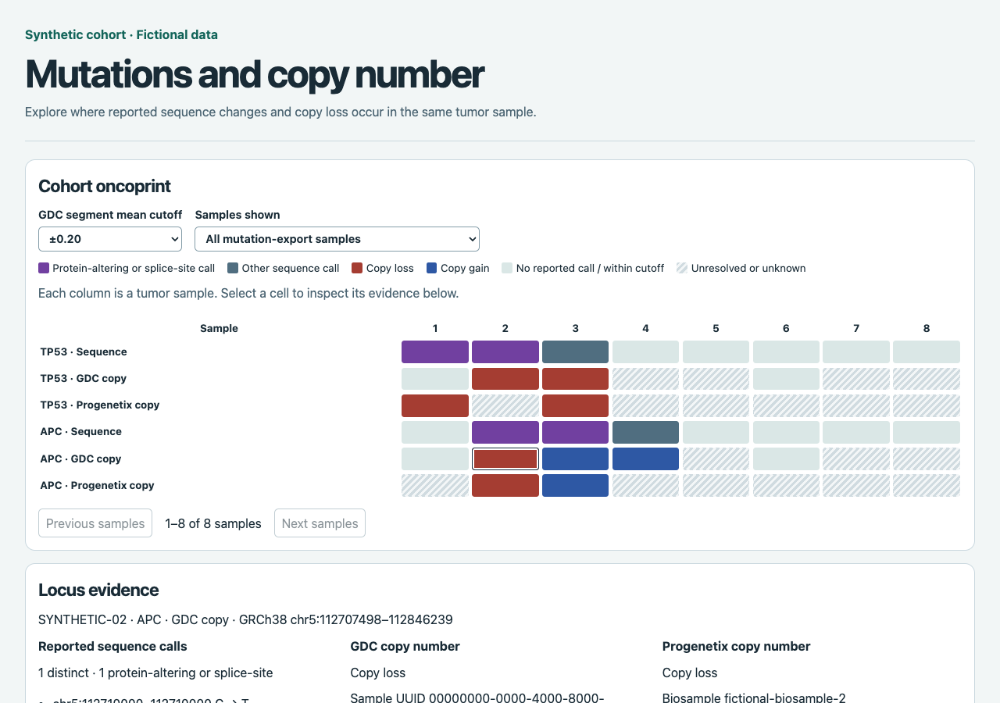
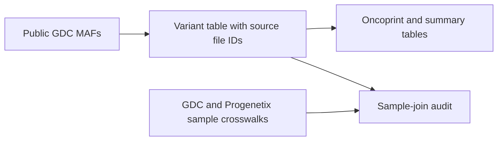

# maf4pgx — From TCGA mutation files to auditable cohort summaries

maf4pgx turns public TCGA mutation annotation files (MAFs) into a traceable variant table, a mutation oncoprint, and cohort summaries. A separate audit checks whether each mutation sample maps unambiguously to a Progenetix biosample before copy-number integration.

## Explore mutations and copy number



Download the [synthetic demo](examples/showcase/synthetic.copy-number.html) and open it in a browser. The demo uses eight fictional samples. Once the Pages workflow deploys, the [hosted demo](https://kvongruenigen.github.io/maf4pgx/) opens directly.

1. Select **sample 2** in the **APC · GDC copy** row. The evidence panel shows a nonsense mutation, a segment mean of −0.25, and the source identifiers.
2. Change the GDC cutoff from **±0.20** to **±0.15**. The TP53 co-occurrence count moves from **1 of 4** to **2 of 4** because sample 1 now meets the copy-loss cutoff.
3. Switch the sample selector to the cached Progenetix comparison. Compare the per-gene denominators and the counts of unknown Progenetix evidence.

In the TCGA-COAD run at ±0.20, GDC copy loss and a reported protein-altering or splice-site call occurred together in **161 of 398** evaluable samples for TP53 and **68 of 392** for APC.

To rebuild the report offline with Python and Bioconductor, run:

```sh
python3 examples/showcase/run_report.py
```

The report build requires R with `GenomicRanges` and `jsonlite`. See the [setup and TCGA-COAD commands](docs/public_workflow.md#build-the-interactive-copy-number-report).

## Try it offline

From the repository root, run this with **Python 3.9 or newer**:

```sh
python3 examples/showcase/run_demo.py
```

Open the SVG path printed by the demo. Next to it, you'll find TSVs for gene counts, distinct calls per sample, recurrent alleles, gene co-occurrence, and sample matches. The run uses a temporary directory and [small synthetic fixtures](examples/showcase/) with no downloads or credentials. Pass `--output-dir PATH` to save the results somewhere specific.

## How it works



- **Trace each call to its source.** The export retains GDC file IDs, original MAF coordinates and alleles, and repeated observations so you can trace rows back to the source.
- **Count distinct calls within samples.** The plot and summaries collapse repeated observations using the reference build, coordinates, and alleles. Percentages use all samples represented in the all-gene export, even when a sample has no calls in the displayed genes. Samples with zero reported calls across the entire export are outside the denominator.
- **Make uncertain joins visible.** The audit requires a unique sample-level GDC UUID and an unambiguous Progenetix biosample. Missing and ambiguous matches remain in the audit table. This step checks identifiers for future CNV integration; it does not produce combined SNV/CNV results.

See the [public TCGA workflow](docs/public_workflow.md) for live downloads and output definitions, or the [Beyond CNVs thesis workflow](docs/thesis_workflow.md) for the original Progenetix import and ClinVar annotation steps.
